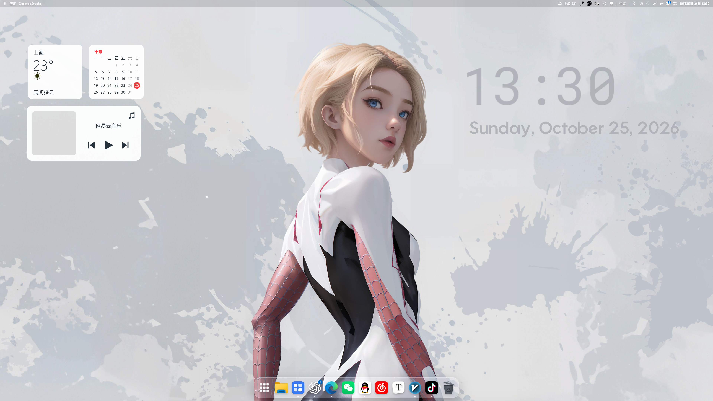
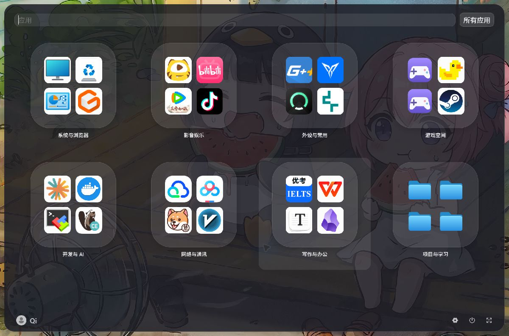
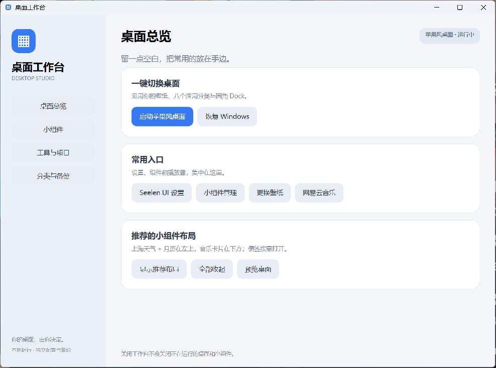
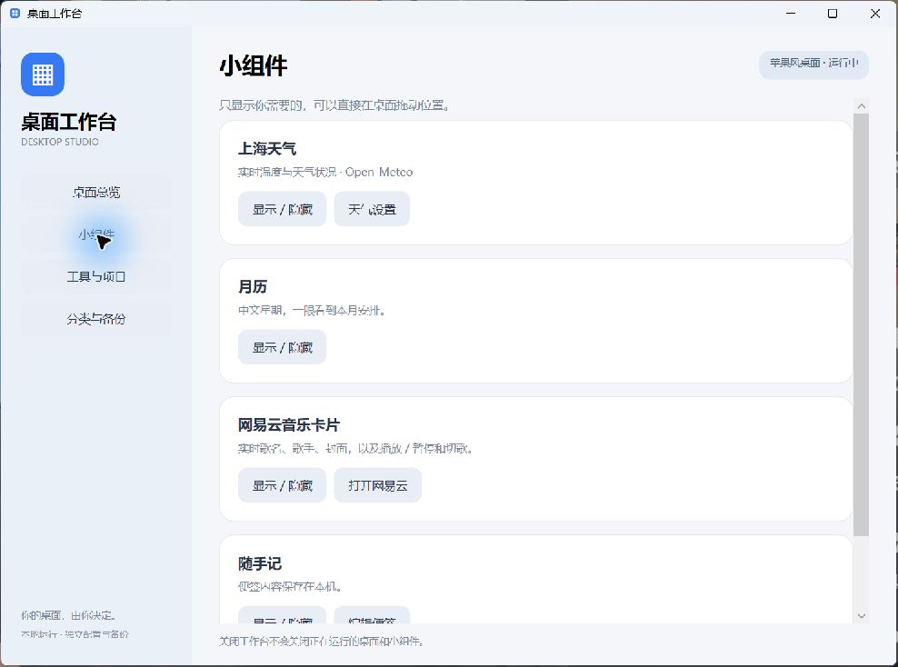

# Desktop Studio · 桌面工作台

[中文](README.md) | **English**

A small native workbench for a coordinated Windows desktop: start a macOS-inspired
layout, restore the Windows desktop, and manage the dock, toolbar, shortcut groups
and desktop widgets from one place.

This is an **integration bundle and preset project**. Seelen UI, Rainmeter and
Monterey provide the desktop engines and skins. This repository adds the native UI,
start/restore scripts, a soft white theme, native DPI configuration and a dedicated
NetEase media bridge. Upstream projects keep their authorship and licenses.

## Desktop showcase



Actual desktop capture at **3840 × 2160**, with the music card idle.
The example wallpapers, application icons and personal application arrangement
are not distributed with the integration package.



Folder previews and expanded application icons use square layout boxes while
preserving each image's original aspect ratio.

## Native workbench



## Features

| Feature | Behavior |
| --- | --- |
| One-click switching | Start the shell and widgets, or restore the Windows taskbar and desktop icons |
| Soft white widgets | Weather, Chinese calendar, music card and optional notes; subtle transparency and rounded corners |
| Native DPI rendering | Default square widgets are about 294 × 294 physical pixels; music is about 612 × 294 |
| Shared dual-monitor dock | Pinned and running applications appear on both monitors |
| Full toolbar | Weather, tray, input language, Bluetooth, network, audio, notifications, quick settings and date |
| Eight shortcut groups | Copy shortcuts into category folders, then synchronize from the workbench |
| NetEase media bridge | Title, artist, artwork, transport controls; stays attached to NetEase rather than another media app |
| Local backups | Keep layout and widget settings separate from the public source |

The workbench uses **C# / WPF**. Closing its window leaves the desktop components running.

Native DPI mode is enforced for each runtime launch rather than relying only on
environment-specific compatibility settings. Weather refreshes data directly;
bundled toolbar compatibility entries prevent system buttons from disappearing
after a weather refresh.

## Install

Requires **Windows 11 x64, .NET Framework 4.8 and the WebView2 runtime required by
Seelen UI**. NetEase Cloud Music and Wallpaper Engine are optional external applications.

1. Download `DesktopStudio-*-win-x64.zip` from
   [Releases](https://github.com/Qi-95827/desktop-studio/releases) and extract the entire archive.
2. Run `Install.cmd`. The default folder is **`D:\Program Files (x86)\DesktopStudio`**.
   Initial setup downloads three pinned upstream components and verifies their SHA-256 hashes.
3. Exit Seelen UI first if it is already running. Setup backs up its configuration
   before applying the dock, toolbar and favorite-group preset.
4. Open the **桌面工作台** shortcut and choose **启动苹果风桌面**.

To use another drive or folder:

```powershell
.\scripts\Install.ps1 -InstallRoot 'D:\Program Files (x86)\DesktopStudio'
```

Inspect the plan without changing the desktop:

```powershell
.\scripts\Install.ps1 -Plan
```

This is an **online-first integration package**, not an offline mirror of upstream
installers. Publisher URLs, versions and hashes are in
[dependencies.lock.json](dependencies.lock.json). Verified downloads are cached
under `downloads/`. The Seelen installer or system runtimes may require their own
installation permissions and system locations; choosing D: does not override those requirements.

## Usage



- **桌面总览**: start/restore the desktop, open settings, reset widget placement, preview the desktop.
- **小组件**: toggle weather, calendar, music and notes; edit the note.
- **工具与项目**: upstream project links and their native settings.
- **分类与备份**: synchronize shortcuts, back up settings, edit application paths.

Starting the desktop registers a current-user login startup entry and saves the
selected desktop mode. Future logins restore that mode automatically. Choosing
**恢复 Windows** saves Windows mode for the next login. The workbench window does
not need to stay open. Disable `DesktopStudio` in Windows Startup Apps to stop automatic startup.

### NetEase Cloud Music

Enable **设置 → 系统 → 开启 SMTC** in NetEase. Setup looks for common installation
paths; if needed, set `NetEaseExe` in local `config.json`. The bridge only reads and
controls the `cloudmusic.exe` Windows media session and does not patch the client.
Lyrics are not included. Artwork quality is limited by the original thumbnail
provided by NetEase; native DPI rendering cannot recover missing image detail.

### Shortcut groups

Copy `.lnk` or `.url` files into the eight folders under `Collections/`, click
**同步快捷方式**, and reopen the application menu. The package ships no personal
shortcuts and does not move your original files.

### Weather and wallpaper

The default city is Shanghai. Set `City`, `Latitude` and `Longitude` in `config.json`,
then reapply configuration to update the weather card. Weather data comes from
[Open-Meteo](https://open-meteo.com/).

Set `WallpaperEngineExe` to enable the optional wallpaper picker. No wallpapers,
Workshop content or Wallpaper Engine binaries are included, and the package keeps
your existing wallpaper. `RestoreWallpaperEngine` is off by default.

## Files and local data

| Path | Purpose |
| --- | --- |
| `src/` | Native WPF launcher, media-thumbnail bridge, DPI manifest |
| `scripts/` | Build, setup, desktop profiles, backups, shortcut synchronization and media bridge |
| `presets/SeelenUI/` | Original theme, plugins and full toolbar layout |
| `presets/Monterey/` | CC BY-NC-SA 4.0 derivative overlay files |
| `runtime/Rainmeter/` | Generated portable runtime and skins; ignored by Git |
| `config.json` | Local application paths and preferences; ignored by Git |
| `Data/`, `Backups/`, `Collections/` | Local state, backups and personal shortcuts; ignored by Git |

Seelen UI retains its own user-data directory. Setup stores an earlier copy under
the package's `Backups/`. **恢复 Windows** changes the active desktop; it does not
uninstall applications or roll back the pre-installation Seelen configuration.

## Build from source

```powershell
.\scripts\Verify.ps1
.\scripts\Build.ps1
.\Start.cmd
```

Build uses the Windows .NET Framework x64 compiler and writes to `bin/`. Run setup
before using desktop functions because source checkouts do not contain the third-party
runtimes. `scripts/Package.ps1` produces a Release ZIP with the prebuilt launcher.

## Behavior notes

- Closing Rainmeter's manager is fine; exiting its background process removes the widgets.
- Dock badges may count retained Windows notifications rather than unread content inside an app.
- The dock and toolbar share their layout across monitors. Rainmeter cards are individual
  windows placed on the primary display by default; drag them elsewhere as needed.
- Restoring Windows toggles desktop-icon visibility without moving or deleting files.
- Back up local settings before replacing a package version. Never publish personal
  `Data/`, `Backups/`, `Collections/` or `config.json` files.

## Credits and licensing

Thanks to [Seelen UI](https://github.com/eythaann/Seelen-UI),
[Rainmeter](https://github.com/rainmeter/rainmeter),
[Monterey Rainmeter](https://github.com/creewick/MontereyRainmeter) and their plugin authors.
See [THIRD_PARTY_NOTICES.md](THIRD_PARTY_NOTICES.md) for versions, roles and licenses.

The original launcher and integration scripts use [MIT](LICENSE). Monterey-derived
skins remain **CC BY-NC-SA 4.0**; integration does not remove their noncommercial
or share-alike requirements.
